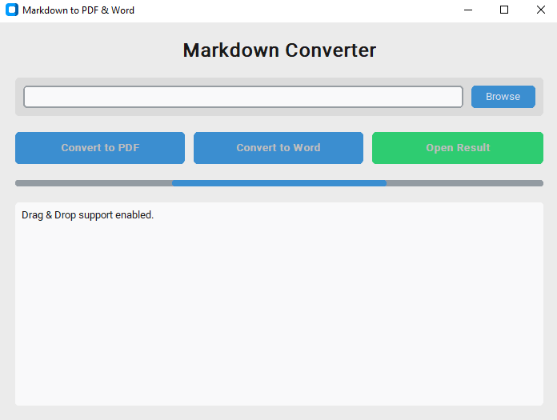

# Markdown to PDF & Word Converter

A modern desktop application for converting Markdown files to PDF and Word (.docx) formats with a beautiful graphical interface.

## Features

- **Drag & Drop Support**: Simply drag your Markdown files onto the application window
- **Browse Button**: Traditional file selection for those who prefer it
- **Dual Conversion**: Convert to both PDF and Word formats with one click
- **Modern Interface**: Built with CustomTkinter for a sleek, modern look
- **Theme Support**: Automatically adapts to system light/dark mode
- **Progress Feedback**: Visual indication during conversion process
- **Result Opening**: Automatically opens converted files upon completion
- **Error Handling**: Clear error messages for troubleshooting

## Preview

## Quick Setup

To get started quickly, download the pre-built portable version:

[**Download MarkdownToPDF.rar**](MarkdownToPDF.rar)

### Installation Instructions

1. Download the `MarkdownToPDF.rar` file using the link above
2. Extract the contents of the RAR archive to your desired location
3. Run `MarkdownToPDF.exe` - no installation required!
4. Start converting your Markdown files to PDF and Word formats

## System Requirements

- Windows 10 or later
- No additional software installation needed (portable version)
- Works on both 32-bit and 64-bit systems

## How to Use

1. Launch the application
2. Either:
   - Drag a Markdown (.md) file onto the window, or
   - Click the "Browse" button to select a file
3. Click either "Convert to PDF" or "Convert to Word"
4. Wait for the conversion to complete (progress bar will indicate activity)
5. Click "Open Result" to view your converted file
6. The converted file will be saved in the same directory as the source file

## Technical Details

This application is built with:
- Python 3.12
- CustomTkinter for the modern GUI
- Playwright for high-quality PDF rendering
- PyPandoc for Word document conversion
- Packaged with PyInstaller for portable distribution

## Support

If you encounter any issues or have feature requests, please check the sample.md file included in the package for formatting examples that work perfectly with this converter.

---

*Created with ❤️ for developers, writers, and anyone who works with Markdown.*