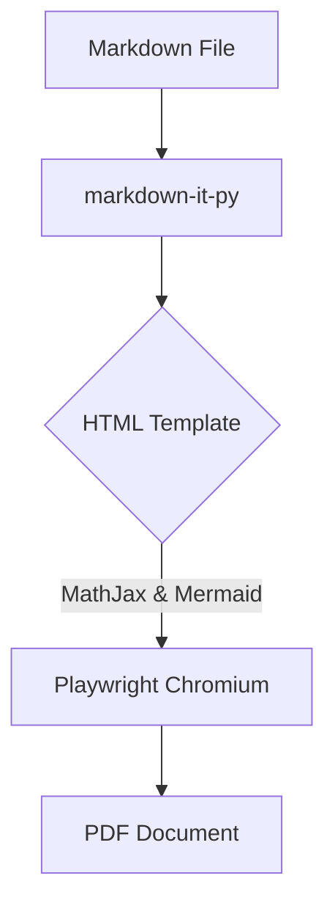

# Introduction to Application

This is a sample document to test the *Markdown to PDF Converter*. It includes several challenging formatting elements such as MathJax equations and Mermaid.js diagrams to ensure the underlying rendering engine, **Playwright**, behaves correctly.

## 1. Standard GFM Elements

| Feature | Support | Note |
|---|---|---|
| Tables | Yes | GFM Plugin required |
| Strikethrough | Yes | `~~strike~~` -> ~~strike~~ |
| Autolinks | Yes | https://example.com |

## 2. Mathematical Equations (MathJax)

We check inline math such as $E = mc^2$ and block math:

$$
\frac{-b \pm \sqrt{b^2 - 4ac}}{2a}
$$

$$
\int_0^\infty e^{-x^2} dx = \frac{\sqrt{\pi}}{2}
$$

## 3. Diagrams (Mermaid.js)

Below is a flowchart representing the conversion process:

## Conclusion

If all these elements are visibly correctly formatted in the final PDF, the conversion pipeline is robust and ready for production use.
